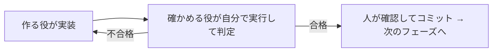

# 5. 組み合わせる — 作る役と確かめる役で回す

## 考え方

エージェントの「できました」は、そのままでは証拠になりません。そこで次の 3 つを決めておきます。

1. **作る役と確かめる役を分ける。** 確かめる役は自分で実行して確かめ、コードは直さない。
2. **合格の条件を先に書いておく。** 「正しく動く」ではなく、誰が見ても同じ判定になる形で。
3. **作業を小さく区切る。** 1 区切り(フェーズ)ずつ、合格したら次へ進む。

この仕組みを、ここでは**ユーザーハーネス**と呼びます。



不合格が 3 回続いたら止めて、人が作業を小さく分け直します。

## 使うもの

ぜんぶ [templates/](templates/HARNESS.md) に雛形があります。`{{ }}` の所を埋めて使います。

| ファイル | 役目 | 置き場 |
| --- | --- | --- |
| [HARNESS.md](templates/HARNESS.md) | フェーズの区切りと合格の条件 | リポジトリのいちばん上 |
| [implementer.agent.md](templates/implementer.agent.md) | 作る役 | `.github/agents/` |
| [reviewer.agent.md](templates/reviewer.agent.md) | 確かめる役(コードを直さない) | `.github/agents/` |
| [phase-loop/SKILL.md](templates/phase-loop/SKILL.md) | 1 周の進め方(スキル) | `.github/skills/phase-loop/` |
| [TEST_REPORT.md](templates/TEST_REPORT.md) | 結果の記録 | `docs/` |

これまでの 4 ページで出てきた部品(指示・スキル・カスタムエージェント)を組み合わせただけです。

## 始め方

1. 雛形を上の置き場にコピーする。
2. HARNESS.md の中身は、エージェントと相談して埋める。

   ```text
   HARNESS.md の雛形を埋めて。このリポジトリの作業を、1 つが短時間で終わる大きさのフェーズに分けて。
   各フェーズの合格条件は 3〜5 個、コマンドの結果や値で確かめられる形で書いて。
   Phase 0 は「ビルドとテストが通る」にして。
   ```

3. 出てきた案を人が見て、**減らす・厳しくする**。エージェントの案は多くて甘くなりがちです。
4. `/phase-loop 0` と打って、Phase 0 を 1 周回す。

## 合格の条件の書き方

| よくない(人によって判定が変わる) | よい(誰が見ても同じ) |
| --- | --- |
| 正しく動く | `--help` を実行すると 4 つのコマンド名が表示される |
| 前と同じ結果になる | 設定 12 項目の読み込み結果が、期待する表と一致する |
| クラッシュしない | おかしな入力を 10 回与えても、プログラムが終了しない |

## 大事な約束は 3 つ

- **確かめる役はコードを直さない。** 直したくなったら不合格にする。
- **確かめる役は自分で実行する。** 作る役の報告を信じない。
- **3 回で合格しなければ、人が作業を分ける。** モデルを変えても解決しないことが多いです。

## 育て方

確かめる役がバグを見逃したら、その確認観点を reviewer に 1 行足します。
合格の条件が判定しにくかったら、HARNESS.md の書き方を直します。仕組みそのものも、使いながらエージェントと一緒に直していきます。

---

前: [4. MCP](04-mcp.md) / [入門の目次](README.md)

入門はここまでです。慣れてきたら [詳細資料・上級者向け](advanced/README.md) へ。
