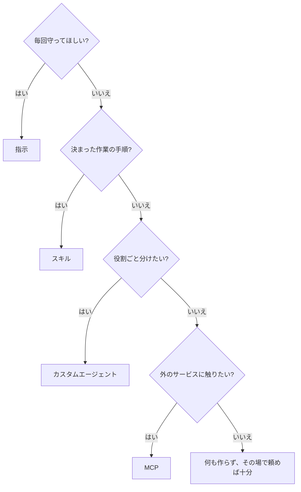

# エージェントのカスタマイズ入門

GitHub Copilot などのエージェントに「このリポジトリではこうしてね」を覚えさせる方法の入門です。
読むのに 30 分ほど。最後まで読んだら、自分のリポジトリで 1 つ作ってみてください。

## 最初に覚えること

1. **部品は 4 つだけ。** 指示・スキル・カスタムエージェント・MCP。
2. **中身はただのテキスト。** 決まった場所に Markdown を置けば、エージェントが読んでくれる。
3. **自分で全部書かなくていい。** エージェントに「こういうのを作って」と頼んで下書きを出してもらい、使いながら一緒に直していく。最初から完璧を目指さない。

## 4 つの部品

| 部品 | ひとことで | いつ読まれる | 置き場 |
| --- | --- | --- | --- |
| [指示](01-instructions.md) | いつも守ってほしい約束ごと | 毎回 | `AGENTS.md` |
| [スキル](02-skills.md) | 特定の作業の手順書 | その作業を頼んだとき | `.github/skills/<名前>/SKILL.md` |
| [カスタムエージェント](03-agents.md) | 役割を決めた助っ人 | 呼んだとき | `.github/agents/<名前>.agent.md` |
| [MCP](04-mcp.md) | 外のサービスとつなぐ口 | そのサービスを使うとき | 画面かコマンドで追加 |

どれを使うか迷ったら、次の順に考えます。

## 読む順

| 順 | ページ | 目安 |
| --- | --- | --- |
| 1 | [指示 — いつも守ってほしい約束ごと](01-instructions.md) | 5 分 |
| 2 | [スキル — 特定の作業の手順書](02-skills.md) | 5 分 |
| 3 | [カスタムエージェント — 役割を決めた助っ人](03-agents.md) | 5 分 |
| 4 | [MCP — 外のサービスとつなぐ口](04-mcp.md) | 5 分 |
| 5 | [組み合わせる — 作る役と確かめる役で回す](05-user-harness.md) | 10 分 |

## 始める前に

- GitHub Copilot のアプリか CLI が使えること。
- エージェントを**リポジトリのいちばん上のフォルダ**で開くこと。別の場所で開くと、置いたファイルが見つかりません。

## 慣れてきたら

入門では、細かい仕様・設定の全一覧・うまくいかないときの原因・設計の理由を省いています。
使っていて「なぜ?」「もっと細かく?」が出てきたら、[詳細資料・上級者向け](advanced/README.md) を必要な章だけ引いてください。
