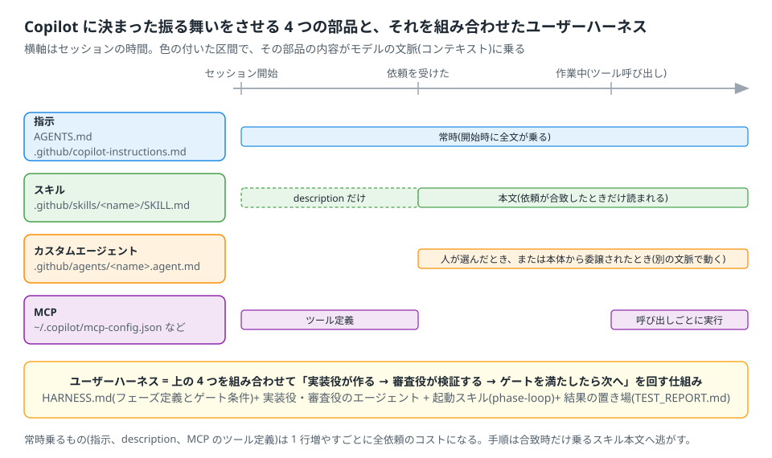

# 1. 指示ファイル — 常時読まれる前提の置き方

指示ファイルは、セッションの開始時に全文が文脈に乗り、そのリポジトリでの全ての依頼・全てのエージェントに効く「前提」の置き場。
4 つの部品の中で一番単純で、一番コストが見えにくい(毎回の依頼に全文が乗る)。



## 1.1 仕組み

- セッション開始時に、決まった場所の指示ファイルを**全部読んで結合**する ◎。ファイル間に優先順位は無く、同じ内容の重複は除かれる ◎。
- 読まれた内容は、その後の全ての依頼で文脈に乗ったまま。依頼ごとに読み直すのではない。
- セッション中に指示ファイルを編集しても、**動いているセッションには反映されない** ◎。再起動するか `/new` で新しいセッションを始める。
- `/instructions` で読まれたファイルの一覧を見て、個別に無効にできる ◎。`--no-custom-instructions` で全部を無効にできる ◎。

## 1.2 Copilot が読む場所(2026-10 時点 ◎)

| 層 | 場所 | 効く範囲 |
| --- | --- | --- |
| ユーザー | `~/.copilot/copilot-instructions.md`、`~/.copilot/instructions/**/*.instructions.md` | 自分の全リポジトリ |
| リポジトリ全体 | `AGENTS.md`、`.github/copilot-instructions.md` | そのリポジトリの全依頼 |
| ディレクトリ | 作業中のファイルの経路にある `AGENTS.md`(ルートから作業ディレクトリまでの中間ディレクトリと、扱っているファイルの親ディレクトリ) | そのディレクトリ以下を扱うとき |
| パス別 | `.github/instructions/**/*.instructions.md`(frontmatter の `applyTo` に glob) | glob に合うファイルを扱うとき |
| 他環境由来 | `CLAUDE.md`、`.claude/CLAUDE.md`、`GEMINI.md` | 読む(他環境と共存できる) |

- `AGENTS.md` と `copilot-instructions.md` の両方があれば両方読まれる(結合される)。
- `copilot-instructions.md`、`AGENTS.md`、`CLAUDE.md` の中では `@相対パス` で別ファイルを取り込める ◎。絶対パスと `~/` は読まれない ◎。
- `applyTo` は glob で、複数はカンマ区切り(例 `"**/*.cpp,**/*.h"`)◎。
- **アプリ**では、設定画面に「App instructions」(全体)と Projects ごとの「Instructions」欄がある(2026-10 時点の表記 ◎)。アプリがリポジトリの `AGENTS.md` を読むかは
  公式文書に明記が無い ▲。CLI の上に構築されているので読むと推測しているが、**手元の環境で確かめる**(第 1.5 節)。
- カスタムエージェントを本体から委譲で呼んだときは、既定ではリポジトリの指示を**受け取らない**。受け取らせるにはエージェント定義に
  `include-custom-instructions: true` を書く ◎(第 3 章)。`/agent` や `--agent` で人が選んだときは読む ◎。

### どのファイル名を使うか

| 名前 | 誰が読むか | 使い分け |
| --- | --- | --- |
| `AGENTS.md` | Copilot ◎、OpenCode ◎、Codex ◎、Claude Code(`CLAUDE.md` が無いときだけ)◎ | **全環境共通の前提**。デファクトスタンダード |
| `.github/copilot-instructions.md` | Copilot ◎ | Copilot だけに向けた前提(例: Copilot の面ごとの注意) |

迷ったら `AGENTS.md` に書く。Copilot 専用の内容が出てきたときだけ `copilot-instructions.md` を足す。

## 1.3 書き方の原則

1. **前提を書く。手順を書かない。** 「常にこうである」(ビルドのコマンド、報告の言語、触ってはいけない場所、コミットしない)は指示。
   「〜のときはこうする」(変換の手順、レビューの観点)はスキル(第 2 章)。手順を指示に書くと、関係ない依頼でも毎回読まれる。
2. **短く。** 毎回の依頼に全文が乗る。目安として 100 行を超えたら、パスで切れる部分を `applyTo` 付きの分割指示に移す ▲(行数の閾値は経験則)。
3. **正典は 1 か所。** 同じ規約をユーザー層・リポジトリ層・エージェント定義に複製しない。複製すると、直したときに届かない箇所が残る
   (同じ規約を 5 か所に複製して、解禁が 8 日間届かなかった事例がある △)。他の場所からは「`AGENTS.md` を見よ」と参照だけ書く。
4. **推測を事実のように書かせない規則を入れる。** 「測った値と見た出力だけを報告する」「文書が見つからなければ止めて報告する」は、
   どのプロジェクトでも効く数少ない前提。
5. **パスで切れる規約は `applyTo` に出す。** 「`src/platform/**` では OS API を直接呼ばず `Platform` 経由にする」のような規約は、
   そのディレクトリを扱うときだけ読まれればよい。

## 1.4 例: CMake プロジェクトの AGENTS.md

導入編の実演で使った CMake プロジェクトを前提にした最小の例。これ以上長くするなら、第 2 章以降の部品へ逃がすことを先に考える。

```markdown
# このリポジトリで作業するときの前提

- ビルド: `cmake --build build`。テスト: `ctest --test-dir build --output-on-failure`。
  どちらも成功するまで「完了」と報告しない。失敗したら出力の末尾 20 行を貼る。
- 報告は日本語。測った値・見た出力だけを書く。「おそらく」「はず」を書かない。
- コミットしない。差分は作業ツリーに残し、人が確認する。
- `tests/` 配下のテストコードを変えない。変えないと通らないときは止めて、どのテストを・なぜ・どう変えたいかを報告する。
- 外部ライブラリの API を呼ぶときは、インストール済みの版のヘッダか文書の該当箇所(path:line)を報告に添える。
- 分からないことは推測で進めず、選択肢を並べて聞く。
```

パス別の例(`.github/instructions/platform.instructions.md`):

```markdown
---
applyTo: "src/platform/**"
---
このディレクトリでは OS 固有 API を直接呼ばない。`Platform` 抽象を経由する。
新しい OS API が必要なら、`Platform` にメソッドを足す提案を報告に書いて止まる。
```

## 1.5 目で確認する

| 確認 | 方法 |
| --- | --- |
| どのファイルが読まれたか | セッション内で `/instructions`。非対話なら `copilot instruction list` ◎ |
| 読まれた環境の全体(指示・MCP・スキル・エージェント・フック) | `/env` ◎ |
| 効いているか | 指示に書いた規則に反する依頼(例: 「コミットして」)を打ち、断るか確認する |
| アプリで `AGENTS.md` が読まれるか | アプリでリポジトリを開き、上と同じ依頼を打つ。読まれていなければ Settings の Instructions 欄に同じ内容を置く ▲ |

📷 SS-1: `/instructions` の出力(読まれたファイルの一覧)

## 1.6 落とし穴

- **編集したのに効かない。** 動いているセッションは開始時の内容を持ち続ける。`/new` で始め直す。
- **長い指示が静かにコストを上げる。** 毎回の依頼に全文が乗るので、1 行足すたびに全依頼の入力が増える。使っていない規約は消す。
- **複製した規約が食い違う。** ユーザー層とリポジトリ層に似た規約を書くと、結合されて両方効く。矛盾があるとどちらが勝つかは決まっていない ◎(優先順位は定義されていない)。
- **サブエージェントに届いていない。** 委譲で呼ばれたカスタムエージェントは既定でリポジトリの指示を受け取らない ◎。実装役・審査役の定義に
  `include-custom-instructions: true` を書く(第 3 章・第 5 章の雛形には入れてある)。
- **他環境のファイルも読まれる。** `CLAUDE.md` があるリポジトリでは Copilot もそれを読む ◎。Claude Code 専用の記述(ツール名など)が混ざっていないか見る。

---

参照(付録 G): GitHub Docs「Add custom instructions to Copilot CLI」「Copilot CLI command reference」「Customize the GitHub Copilot app」。
