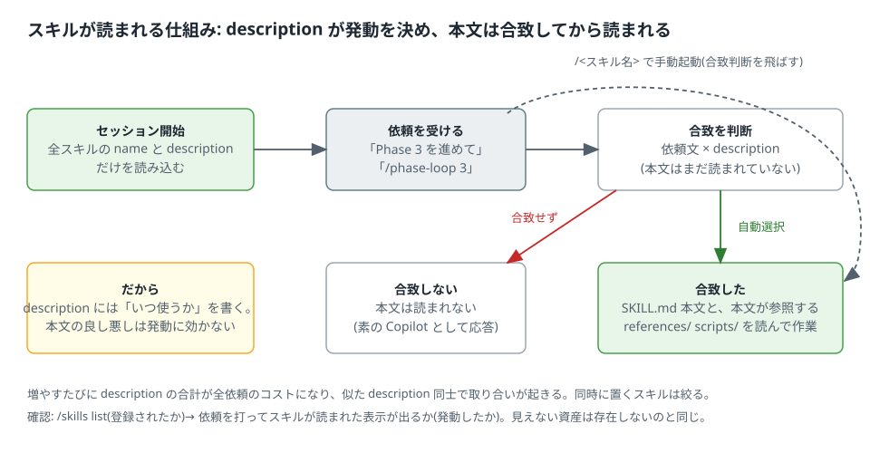

# 2. スキル — 手順と知識を「必要なときだけ」読ませる

スキルは、特定の作業の手順や、素のモデルが知らない事実をまとめた Markdown(`SKILL.md`)。
指示ファイルと違い、**常時読まれるのは frontmatter の `description` だけ**で、本文は依頼が合致したときに読まれる。
この仕組み(段階的な開示)が、スキルを増やしても文脈が膨らまない理由であり、同時に「description が全て」である理由。

形式は **Agent Skills** というオープンな仕様(agentskills.io)で、Copilot のほか Claude Code・OpenCode・Codex などが同じ形式を読む ◎。
4 つの部品の中で最も持ち運びが効く。



## 2.1 仕組み

1. セッション開始時に、探索場所にある全スキルの `name` と `description` を読み込む ◎。
2. 依頼を受けるたびに、依頼文と description を照合して使うスキルを選ぶ ◎。
3. 選ばれたスキルの `SKILL.md` 本文が文脈に注入される ◎。本文が参照する同梱ファイル(`references/` `scripts/`)は、本文の指示に従って読まれる。
4. 人が `/スキル名` で指名すれば、照合を飛ばして本文が読まれる ◎(例: `/markdown-checker check README.md`)。

ここから出る原則は 3 つ。

- **description が発動の全て。** 本文がどれほど良くても、description が依頼に合致しなければ読まれない。
- **description は毎回のコスト。** 全スキルの description が常時文脈に乗る。1 本増やすたびに全依頼の入力が増え、似た description 同士で取り合いが起きる。
- **本文には「合致した後」に要ることだけ書く。** 発動条件を本文に書いても意味が無い(読まれた時点で既に発動している)。

## 2.2 形式(Agent Skills 仕様 ◎)

```text
<skill-name>/
├── SKILL.md        必須。frontmatter + 本文
├── scripts/        任意。実行するコード
├── references/     任意。長い資料(本文から相対パスで参照)
└── assets/         任意。雛形やリソース
```

```markdown
---
name: build-and-test
description: Use when asked to build the project, run the tests, or check why a build or test fails (e.g. "ビルドして", "テストを回して", "ビルドが通らない"). Not for writing new tests or changing the build configuration.
---

# ビルドとテスト

## 手順
1. `cmake --build build` を実行し、失敗したら出力の末尾 20 行を貼って止まる。
2. `ctest --test-dir build --output-on-failure` を実行し、件数(成功 / 失敗 / skip)を報告する。
3. 失敗したテストは、テスト名と失敗したアサーションの行を報告する。テストコードは変えない。

## 品質基準
- 「おそらく通る」と書かない。実行した結果だけを書く。
- 前回より件数が減っていたら、減った分のテスト名を挙げる。
```

| 項目 | 仕様 |
| --- | --- |
| `name`(必須) | 1〜64 字。小文字英数字とハイフンのみ。先頭・末尾にハイフン不可、連続ハイフン不可。**ディレクトリ名と一致** |
| `description`(必須) | 1〜1024 字。何をするかと**いつ使うか**の両方 |
| 任意のキー | `license`、`compatibility`(〜500 字)、`metadata`(文字列の map)、`allowed-tools`(実験的) |
| 本文 | 500 行以内を推奨。長い資料は `references/` に分ける |
| 検証 | `skills-ref validate ./<skill-name>`(仕様の公式ツール) |

Copilot CLI が追加で解釈するキー ◎: `allowed-tools`(列挙したツールを**事前承認**する。`shell` を書くとコマンド実行の確認が飛ぶので、使わない)、
`argument-hint`(スキルピッカーに出す引数の例)、`user-invocable`(既定 true。false で `/名前` の手動起動を禁止)、
`disable-model-invocation`(既定 false。true で自動選択を禁止し、手動起動専用にする)。Copilot の `name` は 64 字でコロン・ドット・空白なども許すが ◎、
他環境へ持ち運ぶなら仕様の範囲(小文字英数字とハイフン)に収める。

## 2.3 Copilot での置き場と登録(2026-10 時点 ◎)

| 層 | 場所 |
| --- | --- |
| リポジトリ | `.github/skills/<name>/SKILL.md`、`.agents/skills/<name>/SKILL.md`、`.claude/skills/<name>/SKILL.md`(3 つとも読む) |
| 親ディレクトリ | 親の `.github/skills/`(monorepo = 1 リポジトリに複数プロジェクトを置く構成、向け) |
| 個人 | `~/.copilot/skills/<name>/SKILL.md`、`~/.agents/skills/<name>/SKILL.md` |
| その他 | プラグイン同梱、環境変数 `COPILOT_SKILLS_DIRS`(カンマ区切り)、`--add-dir <path>` の `.github/skills`、組織・エンタープライズ(必要時に取得) |

同名のスキルがあれば**先に見つかった方が勝つ**(リポジトリ > 個人)◎。`.claude/commands/` も別形式として読まれるが優先度は低い ◎。

| 操作 | 方法 |
| --- | --- |
| 一覧 | `/skills list` ◎。非対話は `copilot skill list [--json]` ◎ |
| 詳細 | `/skills info <name>` ◎ |
| 追加 | ファイルを置いて `/skills reload` ◎。または `/skills add [--project] <ファイル / URL / ディレクトリ>`(`--project` でリポジトリ側に入る)◎ |
| 削除・無効化 | `/skills remove <name>` ◎、ダッシュボード(`/skills`)の Enable / Disable ◎、設定 `disabledSkills` ◎ |
| 手動起動 | `/<name> 引数` ◎ |
| アプリ | サイドバーの Customize → Skills ◎。**リポジトリや CLI に設定したスキルは自動でアプリでも使える** ◎ |

置き場は **`.github/skills/`** に統一する。理由は、Copilot の全ての面が読むこと、配布スクリプトの管理対象を 1 つにできること、
他環境(OpenCode・Codex)向けには `.agents/skills/` へのコピーで済むこと(付録 E)。
`.agents/skills/` へコピーすると Copilot には同名が 2 つ見えるが、内容が同一なら先勝ちで実害は無い ▲。気になるなら `.agents/skills/` だけを正にする選択もある(その場合、他の面で見えるかを確認する)。

## 2.4 description の書き方

description は「このスキルに何が書いてあるか」ではなく「**どんな依頼のときに読むべきか**」を書く。判断材料は依頼文と description の照合だけ。

| 悪い(内容の要約) | 良い(場面) |
| --- | --- |
| 設定ファイル形式の仕様と変換手順 | Use when asked to convert a config file from the old format to the current one, or when a config fails to load after migration. Not for explaining the format. |
| フェーズゲートの運用手順 | Use when asked to run, advance, resume or re-review a phase of HARNESS.md (e.g. "Phase 3 を進めて", "phase-loop で回して"). Not for implementing or reviewing a phase directly. |

1. **「Use when ...」で始め、「Not for ...」で終える。** 陽性(発動させたい場面)と陰性(似ているが対象外)を両方書く。陰性が無いと隣のスキルと取り合いになる。
2. **利用者が実際に打つ言い回しを入れる。** 日本語で依頼するなら日本語の言い回しも括弧で入れる。
3. **スキル名を繰り返さない。形容詞を書かない。** 「包括的な」「正確な」は照合に効かない。
4. **2〜3 文で足りる。** 1024 字の上限まで使わない。長い description は毎回のコスト。

発動試験で陰性ケースが発動したら description を**狭める**(Not for を足す)。陽性ケースが発動しなければ、その言い回しをそのまま description に足す。
**本文を直しても発動は変わらない。**

## 2.5 作り方の 5 段

スキルの本文はエージェントに書かせてよい。品質を決めるのは本文の文章力ではなく、**入口(依頼票)と出口(試験・レビュー)を固定すること**。

```text
段 1 依頼票  → 段 2 形式検査 → 段 3 発動試験 → 段 4 レビュー → 段 5 配置
(人が書く)   (機械的)       (実測)        (別の人)      (コピー + 目視)
```

| 段 | すること | 合格条件 |
| --- | --- | --- |
| 1 依頼票 | [templates/skill-request.md](../templates/skill-request.md) を埋める。「発動させたい場面」「させたくない場面」「エージェントが知らない事実と出典」「受け入れ基準」 | 人が書く唯一の入力。票に無い機能はスキルに入れない |
| 2 形式検査 | `name` がディレクトリ名と一致、`description` が 1024 字以内で場面を書いている、本文 500 行以内、同梱ファイルは相対パス、機種依存の絶対パスが無い | 全部機械的に確認できる。`skills-ref validate` も使える |
| 3 発動試験 | 依頼票の陽性・陰性ケースをそのまま打ち、スキルが読まれたか見る | 陽性で発動、陰性で非発動。結果を `.github/skills/<name>/TEST_LOG.md` に残す(REQUEST.md と同じ場所。SKILL.md 本文から参照しないのでエージェントには読まれない) |
| 4 レビュー | 依頼票を書いた人とは別の人が、受け入れ基準と `TEST_LOG.md` を照合する | 票に無いことが本文に無い、事実に出典がある、手順が「意図と品質基準」で書かれている |
| 5 配置 | リポジトリの `.github/skills/` に置き、`/skills list` に出ることを目視 | 見えた日付を `TEST_LOG.md` に 1 行足す |

依頼票をエージェントに渡す依頼文の例:

```text
この依頼票のとおりに .github/skills/build-and-test/SKILL.md を書いて。雛形は docs/customize/templates/SKILL.md。
票に無い機能は足さない。本文は 500 行以内、長い資料は references/ に分ける。
```

`TEST_LOG.md` の形式:

```text
| 日付 | 面 | 入力 | 期待 | 結果 |
|---|---|---|---|---|
| 2026-10-21 | アプリ | ビルドして | 発動 | 発動(スキル読み込みの表示あり) |
| 2026-10-21 | アプリ | 新しいテストを書いて | 非発動 | 非発動 |
| 2026-10-21 | アプリ | テストの書き方を説明して | 非発動 | **発動した** → description を狭める |
```

## 2.6 スキルを増やしすぎない

読み込まれた全スキルの description が毎回の判断に使われるため、資産を 1 つ増やすたびに他の全スキルの発動精度が下がる。
使われていないスキルはリポジトリから外し、管理リポジトリの `archive/` に移す。1 リポジトリに同時に置くのは 10 本以内を目安にする ▲(経験則)。

スキルにする前に自問する: それは「常にこうである」前提(→ 指示)ではないか。1 回しか使わない手順(→ その場で依頼文に書く)ではないか。
特定の役割だけが使う規則(→ カスタムエージェントの本文)ではないか。

## 2.7 目で確認する

| 確認 | 方法 |
| --- | --- |
| 登録されたか | `/skills list` に name と description が出る |
| 発動したか | 陽性ケースを打ち、スキルが読み込まれた旨の表示が出る。CLI では読み込んだファイルが表示される |
| 手動起動できるか | `/<name>` と打つ |
| アプリで見えるか | Customize → Skills に出る |

📷 SS-2: `/skills list` の出力  📷 SS-3: 依頼を打ってスキルが読み込まれた表示

## 2.8 落とし穴

- **description が内容の要約になっている。** 一番多い失敗。発動しないときに本文を直す人が多いが、直すのは description。
- **`allowed-tools: shell` で確認を飛ばしている。** 「スキルを入れたらコマンドの確認が出なくなった」の原因。事前承認は使わない。
- **プロンプトファイルの代わりに。** 定型の起動文はスキルにして `/名前` で呼ぶ(第 5 章の `phase-loop` がその例)。プロンプトファイルを使わない理由は付録 D-1。
- **同名のスキルが複数の置き場にある。** 先に見つかった方だけが使われる ◎。どれが効いているかは `/skills info <name>` で見る。
- **個人用の置き場(`~/.copilot/skills/`)に置いた。** 本人の環境でだけ効き、他の人には無い。チームで使うものはリポジトリに置く。
- **本文に他環境専用のキーや絶対パスが混ざる。** 形式検査(段 2)で機械的に落とす。

---

参照(付録 G): Agent Skills specification、GitHub Docs「About agent skills」「Add skills to Copilot CLI」「Copilot CLI command reference」「Customize the GitHub Copilot app」。
