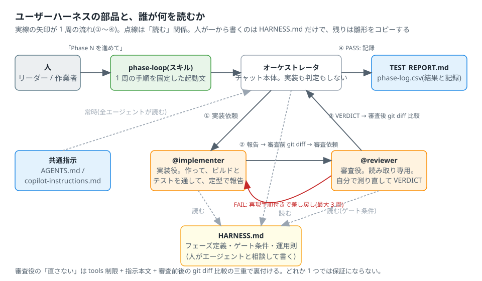
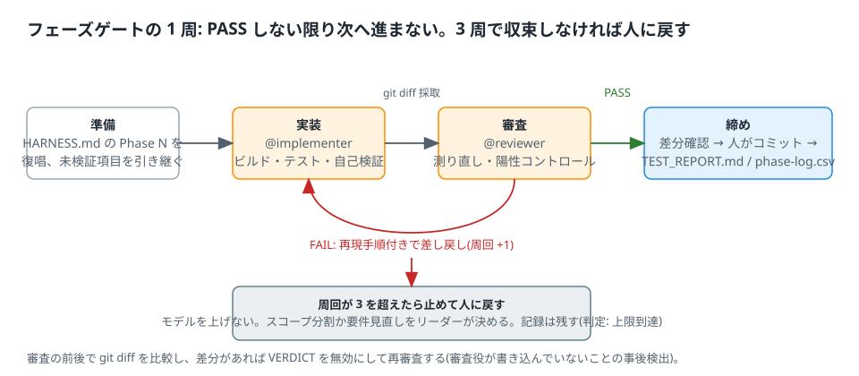

# 5. ユーザーハーネス — 部品を組み合わせて 1 周回す

第 1〜4 章の部品を組み合わせて、「実装役が作る → 審査役が検証する → ゲート条件を満たしたら次へ」を**誰が回しても同じ品質で**再現する仕組みを作る。
この章が本資料の到達点。読み終えたら、自分のリポジトリで雛形を埋め、Phase 0 を 1 周回す。

## 5.1 何を解決するか

エージェントに作業を任せると、次の 4 つが起きる。ユーザーハーネスはこの 4 つに 1 つずつ対策を当てたもの。

| 起きること | 対策 |
| --- | --- |
| 「動きました」が証拠にならない(自己申告) | 作った本人とは別の**審査役**が、自分で測り直して判定する |
| 頼んでいない所まで直す(スコープの膨張) | **HARNESS.md** にフェーズごとの「実装:」1 行とゲート条件を書き、それ以外は「未解決事項」に書かせる |
| 直して壊して直して、が止まらない(周回の暴走) | **起動スキル**で 1 周の手順と周回上限(3 周)を固定し、超えたら人に戻す |
| 後から「どこまで検証したか」が分からない | **TEST_REPORT.md** と **phase-log.csv** に結果と周回数を 1 行ずつ残す |

## 5.2 部品と「誰が何を読むか」



| 部品 | ファイル | 章 | 人が書く量 |
| --- | --- | --- | --- |
| フェーズ定義とゲート条件、運用則 | `HARNESS.md`(ルート) | — | **ここだけ**。エージェントと相談して書く(第 5.4 節) |
| 実装役 | `.github/agents/implementer.agent.md` | 3 | 雛形をコピーし、ビルド・テストのコマンドと `tests/` のパスを埋める |
| 審査役(読み取り専用) | `.github/agents/reviewer.agent.md` | 3 | 同上。プロジェクト固有の攻撃観点を 1 つ足す |
| 1 周の起動文 | `.github/skills/phase-loop/SKILL.md` | 2 | 雛形のまま |
| 結果の置き場 | `docs/TEST_REPORT.md`、`docs/phase-log.csv`、`e2e-artifacts/`(gitignore) | — | 雛形をコピーし、環境 ID と外部 API の版を埋める |
| 共通の前提 | `AGENTS.md` | 1 | 第 1 章の例のまま |

雛形は [templates/](../templates/HARNESS.md) 以下にある。人が一から書くのは HARNESS.md だけで、残りは `{{ }}` を埋めるだけにしてある。

役割の呼び方: 本資料では実装役を `implementer`、審査役を `reviewer` と呼ぶ。Copilot では `/agent` で選ぶか、依頼文で名前を挙げるか、
オーケストレータ(phase-loop を実行しているチャット)が委譲する(第 3 章)。

## 5.3 1 周の流れと運用則



```text
人: 「/phase-loop 2」(または「HARNESS.md の Phase 2 を phase-loop で進めて」)
  → オーケストレータ: HARNESS.md の Phase 2 を復唱、前フェーズの未検証項目を引き継ぐ
  → implementer: 実装 + ビルド/テスト + 自己検証 → 定型報告
  → オーケストレータ: 審査前の git diff と git status を採取
  → reviewer: テスト差分の確認 → 自分で測り直し → 陽性コントロール → 意地悪テスト → VERDICT
  → オーケストレータ: 審査後の git diff と git status を採取して比較(どちらかに差分があれば判定無効)
  → FAIL: 再現手順付きで implementer に差し戻し(最大 3 周)
  → PASS: 差分確認 → 人がコミット → TEST_REPORT.md と phase-log.csv を更新 → 次フェーズへ
     (PASS(条件付き)なら、条件を TEST_REPORT.md の ⚠ セルに書いてから次へ)
```

運用則は HARNESS.md の「運用ルール」節に書いてある。変えない。理由を添えて要約する。

| 則 | 理由(実証で何が起きたか) |
| --- | --- |
| 審査役はコードを直さない | 直せる審査役は実装役に遠慮する。「判定と証拠だけ」にすると敵対的に検証し、実装役の自己検証をすり抜けたバグを捕捉した △ |
| 審査役は自分で測り直す | 実装役の「成功しました」は証拠ではない。同じコマンドを再実行して出力を貼る。嘘の報告 + 仕込んだバグを渡した実測で、全条件を再実行して FAIL を返した △ |
| 再レビューは発見時の再現手順の再実行で閉じる | 修正差分を読んだだけの PASS は、同じ穴が別経路で残っているのを見逃す |
| 陽性コントロールを入れる | 「検出できない検査」が PASS を量産する。壊して検出されることを 1 つ示す。方法を書かないと弱い確認で済まされる △ |
| 未検証は理由付きで残す | 環境起因の障害は時間を区切って見切り、➖ として記録して先へ進む。「なんとなく合格」を作らない |
| 最大 3 周 | 3 周で収束しないフェーズはスコープが大きすぎるか要件が曖昧。モデルを上げても解決しない。人が分割する |
| 完了報告は定型 | 「未解決事項」欄が次のレビュー観点の供給源になる。自由形式だと欄が消える |
| 審査前後の git diff と git status を比較する | 審査役の「直さない」の三重化の 3 層目(第 3 章)。モデルや版が変わっても効く唯一の層。未追跡ファイルの追加は diff に出ないので status も見る |

## 5.4 作る手順

### Step 0: 前提を揃える

- ビルドとテストが**各 1 行**で動く。動かないなら、先にそれを Phase 0 の実装にする。
- `git status` がきれい。`e2e-artifacts/` を `.gitignore` に入れる。
- 第 1 章の `AGENTS.md` が置いてある。

### Step 1: HARNESS.md をエージェントと相談して書く

ここが一番伝わりにくく、一番品質を決める所。**フェーズ分割とゲート条件の草案はエージェントに出させ、人が削る。**
エージェントが出す案は「多くて甘い」のが常なので、人の仕事は足すことではなく削ることと厳しくすること。

1. アプリで **Plan モード**(エージェントが計画を立て、人が承認してから実行するモード ◎)を選ぶ。CLI なら「計画だけ出して、実行しないで」と書く。
2. 依頼文の例:

   ```text
   docs/PLAN.md(設計と要件)を読んで、docs/customize/templates/HARNESS.md の雛形に沿って HARNESS.md の草案を書いて。
   フェーズは 1 つが「1 セッションで 3 周以内に収束する大きさ」に分割して。
   各フェーズの「実装:」は 1 行、ゲート条件は 3〜5 個。ゲート条件は審査役が機械的に確認できる形
   (コマンドと期待する出力、比較する値、スクリーンショットで見える要素)に限り、「正しく動く」「問題ない」は書かないで。
   Phase 0 は環境構築(ビルド・テストが通る、起動確認が終了コード 0)にして。
   ```

3. 出てきた草案を人が削る。見る所は 3 つ。

   | 見る所 | 削る・直す |
   | --- | --- |
   | フェーズの大きさ | 「実装:」行に「と」「および」が 2 つ以上あれば分割する |
   | ゲート条件の確認可能性 | 下の表の「悪い」を「良い」に直す。直せない条件は未検証欄へ |
   | 条件の数 | 5 個を超えたら、テストで担保できるものをテストに移して条件から外す |

   | 悪い(確認できない) | 良い(確認できる) |
   | --- | --- |
   | 引数の処理が正しく動く | `--help` の出力に 4 つのサブコマンドが並び、未知の引数で終了コード 2 を返す(出力の抜粋) |
   | 設定の読み込みが前と同じ | 設定ファイル 12 項目の読み込み値が期待表と一致する(値を表で比較) |
   | クラッシュしない | 未対応の入力を 10 回連打してプロセスが生存している(終了コードと ps の出力) |

4. 「環境」節(ビルド・テスト・実行・仕様書の置き場・外部 API の文書の置き場)を人が埋める。ここはエージェントに書かせない(推測が混ざる)。

### Step 2: 実装役と審査役を置く

- [templates/implementer.agent.md](../templates/implementer.agent.md) と [templates/reviewer.agent.md](../templates/reviewer.agent.md) を `.github/agents/` にコピーし、`{{ }}` を埋め、先頭のコメントを消す。
- `/agent` の一覧に出ることを確認する。
- 審査役を選んで「`src/` の 1 行を直して」と頼み、断ることを確認する(第 3.6 節)。
- 実装役を選んで「ビルドして」と頼み、コマンド実行の確認が出て、実行できることを確認する。

### Step 3: 起動スキルを置く

- [templates/phase-loop/SKILL.md](../templates/phase-loop/SKILL.md) を `.github/skills/phase-loop/SKILL.md` にコピーする。
- `/skills list` に `phase-loop` が出ることを確認する。

### Step 4: 結果の置き場を置く

- [templates/TEST_REPORT.md](../templates/TEST_REPORT.md) を `docs/TEST_REPORT.md` にコピーし、検証環境の表と外部 API の版を埋める。
- `docs/phase-log.csv` は phase-loop が初回に作る。`e2e-artifacts/` を作り、`.gitignore` に入れる。

### Step 5: 導入チェック(陰性コントロールと陽性コントロール)

ハーネスが「回る」ことと「検証する」ことは別。導入時に両方を確かめる。

1. **陰性**: `/phase-loop 0` で Phase 0 が PASS まで通る。FAIL が出たらゲート条件か審査役の指示が厳しすぎる。
2. **陽性**: HARNESS.md 付録 B の壊し方を 1 つ入れて(例: 比較演算子を反転。テストは通る壊し方を選ぶ)、審査役が FAIL を出し、指摘がその箇所を指す。
3. 両方の結果を TEST_REPORT.md の Phase 0 に書く。

| 導入チェックリスト | |
| --- | --- |
| [ ] HARNESS.md のフェーズ 0〜最終まで、ゲート条件が「確認できる」形 | |
| [ ] `/agent` に implementer と reviewer が出る | |
| [ ] 審査役が編集を断る。実装役がコマンドを実行できる | |
| [ ] `/skills list` に phase-loop が出る | |
| [ ] `docs/TEST_REPORT.md` の環境 ID と外部 API の版が埋まっている | |
| [ ] `/phase-loop 0` が PASS まで通る(陰性) | |
| [ ] 壊した実装で FAIL が出る(陽性) | |
| [ ] `docs/phase-log.csv` に Phase 0 の 1 行がある | |

### Step 6: 運用

- **1 フェーズ 1 セッション。** 前のフェーズのセッションを使い回さない(文脈が溜まり、本体が重くなる。第 3.5 節)。アプリではセッションごとに専用の worktree とブランチが作られる(2026-10 時点 ◎)ので、1 フェーズ = 1 ブランチになる。PASS 後に人がマージする。
- **モデルは既定のまま。** 3 周で通らないフェーズはモデルではなくスコープの問題。変えるならリーダーが決め、変えたモデルの名前を phase-log.csv の implementer_model / reviewer_model 列に書く。
- **週 1 回、HARNESS.md 付録 A(順調と判断してよい条件 / 疑うべき兆候)を見る。** 兆候が 2 つ以上当たれば HARNESS.md 付録 B のコントロールをやり直す。全フェーズが 1 周目 PASS なら、審査していない。

📷 SS-11: アプリのセッション一覧(1 フェーズ 1 セッション、各セッションにブランチ名が付いている)

## 5.5 実演: 導入編のバグ修正を 1 周に載せる

導入編で実演した バグ修正(例: バージョン文字列 `"1.2.3"` を解析する関数が `"1.2"` で誤った値を返す)を、Phase 1 として回したときの流れ。
応答は要点だけに縮めてある。

HARNESS.md の Phase 1:

```markdown
### Phase 1: バージョン解析の修正

実装: `src/version.cpp` の `parse_version` が 2 要素の入力でも正しい値を返すようにする

- [ ] `ctest --test-dir build` が全件成功する(前フェーズ 11 件、減っていない)
- [ ] 入力 `"1.2"` で major=1, minor=2, patch=0 を返す(新しいテストを 1 件足してよい)
- [ ] 入力 `""` と `"a.b.c"` でエラーを返し、クラッシュしない(意地悪テストの対象)
```

セッション:

```text
人:  /phase-loop 1

[オーケストレータ] Phase 1 を復唱します: 実装は parse_version の 2 要素入力対応。ゲート 3 件。
  前フェーズの未検証: なし。開始 10:05。implementer に委譲します。

[implementer]
  ## 変更ファイル
  - src/version.cpp — 要素数が 2 のとき patch を 0 にする分岐を追加
  - tests/version_test.cpp — 2 要素入力のテストを 1 件追加
  ## テストコードの変更
  - 追加のみ(削除・スキップ・期待値変更なし)
  ## 外部 API の根拠
  - 外部 API の利用なし
  ## ビルド・テスト
  - cmake --build build: 成功
  - ctest --test-dir build: 12 件中 12 件成功(前フェーズ 11 件)
  ## 自己検証
  - ゲート 2: "1.2" → 1,2,0 を確認
  - ゲート 3: "" と "a.b.c" → invalid を返す
  ## 未解決事項
  - なし

[オーケストレータ] 審査前の差分を採取しました。reviewer に委譲します。

[reviewer]
  ## テストディレクトリの差分
  - git diff HEAD --stat -- tests/: version_test.cpp 1 ファイル、追加のみ
  - ctest 生出力(末尾): 12 tests passed, 0 failed, 0 skipped, exit 0
  ## ゲート条件ごとの結果
  | ゲート 1 | PASS | 12/12、前フェーズ 11 から減っていない |
  | ゲート 2 | PASS | 追加テストの出力を確認 |
  | ゲート 3 | FAIL | "1.2." (末尾ドット) で patch に未初期化値が入る。再現: 下のコマンド |
  ## 陽性コントロール
  - 隔離コピー ../pc-phase1(作業ツリー外)で `if (parts == 2)` を `if (parts == 3)` に変え、ctest が 2 件落ちることを確認
  ## 意地悪テスト
  - "1.2." → 未初期化(問題)、"1..2" → invalid(問題なし)、"999999999999.0" → オーバーフロー未検出(未解決事項として報告)
  ## VERDICT: FAIL
  1. "1.2." で patch が未初期化。再現: ./build/version_cli "1.2." → patch が実行ごとに変わる

[オーケストレータ] 審査後の差分は審査前と一致。FAIL なので 1 周目の指摘を implementer に渡します(2 周目)。
  ... (implementer が修正、ゲート 3 のテストを 1 件追加、13/13)
[reviewer] 前回の再現手順を再実行: "1.2." → invalid。VERDICT: PASS
[オーケストレータ] PASS。差分は src/version.cpp と tests/version_test.cpp のみ、スコープ逸脱なし。
  TEST_REPORT.md の Phase 1 行と phase-log.csv の 1 行(2026-10-21,1,parse_version 2 要素対応,…,2,PASS,…)を差分で提示します。コミットは指示をお待ちします。
```

見る所は 3 つ。審査役は実装役の件数を写さず自分で `ctest` を回した。陽性コントロールは「隔離コピーで壊してテストが落ちた」という方法で書かれた。
FAIL の指摘には再現コマンドが付き、2 周目の再レビューは同じコマンドの再実行で閉じた。この 3 つが無い周回は、回っているだけで検証していない。

📷 SS-8: phase-loop を起動した直後の復唱  📷 SS-9: 審査役の VERDICT: FAIL の報告  📷 SS-10: セッションの使用量表示(本体とサブエージェントの消費が分かれて出る)

## 5.6 共有の仕方

- **管理リポジトリに 1 回書いて、各リポジトリへコピーで配る。** シンボリックリンクやサブモジュールは、エージェント環境の探索が実体を見るため使わない。
- **配布先で育つファイルは上書きしない。** HARNESS.md と TEST_REPORT.md は配った後にそのリポジトリで更新される。再配布で上書きすると結果が消える。初回だけ置き、以後は配布対象から外す。
- **配った後に目で確認する。** `/agent`、`/skills list`、`/instructions` に出ること。見えない資産は存在しないのと同じ。
- **版を記録する。** アプリと CLI の版、配った日付、雛形の版を TEST_REPORT.md の検証環境の表に書く。画面と資料が違っていたら画面が正しい。資料を直す。
- 他のエージェント環境でも同じ HARNESS.md と phase-loop を使える(スキルと指示は共通形式)。実装役・審査役の定義だけは環境ごとに書き直す(付録 E)。

## 5.7 落とし穴

- **全フェーズが 1 周目で PASS する。** 審査していない。HARNESS.md 付録 B の陽性コントロールをやり直す。
- **審査役が実装役の報告を写している。** 報告に `ctest` の生出力が無い。審査役の本文「自分で測り直す」が届いているか(`include-custom-instructions`、委譲の有無)を確認する。
- **モデルを上げて解決しようとする。** 3 周で通らないのはスコープの問題。分割する。
- **本体(オーケストレータ)に実装の詳細を溜める。** 消費が倍になる(第 3.5 節)。本体は渡すだけ。
- **HARNESS.md を直さずに現場で上限を増やす。** 運用則は HARNESS.md を直してから変える。現場で例外を作ると記録と食い違う。
- **ゲート条件に「正しく動く」が残っている。** 審査役は確認できないので PASS にも FAIL にもできず、判定が曖昧になる。

---

参照: [templates/](../templates/HARNESS.md) 以下、第 3 章(委譲のコスト、三重化)、HARNESS.md 付録 A・B。
