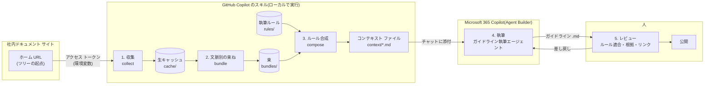

# ドキュメント自動作成ワークフロー

社内のドキュメント サイトを材料に、ガイドライン文書を Copilot で書かせるための工程と約束事。
収集から文脈の束ね・ルール合成までを **GitHub Copilot のスキル(bat / Python のスクリプト)** が担い、
執筆を **Microsoft 365 Copilot のエージェント(Agent Builder)** が担う。人は起点となる URL と
執筆ルールを用意し、出来上がった文書をレビューして公開する。

本文中の制約値は 2026-10 時点の公式文書に基づく。保証ではなくスナップショットとして読むこと。

## 全体図



## 工程

| # | 工程 | どこで動くか | 入力 | 出力 | 形 |
| --- | --- | --- | --- | --- | --- |
| 1 | 収集 | GitHub Copilot のスキル | ホーム URL、アクセス トークン | `cache/` に 1 ページ 1 ファイル | Python |
| 2 | 文脈別の束ね | 同上 | `cache/`、束の目録 | `bundles/<文脈>.md` | Python |
| 3 | ルール合成 | 同上 | `rules/`、`bundles/` | `context/<ガイドライン>.md` | Python |
| 4 | 執筆 | Microsoft 365 Copilot のエージェント | `context/<ガイドライン>.md` を添付 | ガイドライン `.md` | 指示文 + 添付 |
| 5 | レビューと公開 | 人 | ガイドライン `.md`、束 | 公開版 | チェックリスト |

工程 1〜3 は 1 本の bat から順に呼べるようにし、同じスクリプトを GitHub Copilot のスキル(`SKILL.md` + `scripts/`)
からも呼べるようにする。スクリプトは単体でも動くことを前提にし、スキルは「いつ・どの順で・どの引数で呼ぶか」だけを書く。

### 1. 収集(collect)

ホーム URL を起点に、同じサイト配下のリンクをツリー状に辿り、URL ごとにページ本文を保存する。

- **範囲**: 起点と同じホスト・同じパス配下だけを辿る。深さの上限と除外パスを引数で与える。外部リンクは記録するだけで取りに行かない。
- **認証**: トークンは環境変数から読む。スクリプト・設定ファイル・キャッシュに書かない。
- **差分収集**: 本文のハッシュを前回と比べ、変わったページだけ上書きする。削除されたページは一覧から外し、ファイルは `cache/_removed/` に移す。
- **出所の記録**: 各ファイルの先頭に front matter で元 URL・取得日時・本文ハッシュ・タイトル・親ページを持たせる。後の工程と検査の土台になる。
- **形式**: 本体は Markdown に変換して保存する。変換できない要素(埋め込み・画像)は元 URL への参照に置き換える。

### 2. 文脈別の束ね(bundle)

ガイドラインの種類(たとえばパッケージ作成、環境構築、レビュー手順)ごとに、関係するページを 1 本の Markdown にまとめる。

- **目録(manifest)**: どのページがどの文脈に入るかは、人が保守する目録 `bundles/manifest.json` で決める。タグの付与は
  Copilot に下書きさせてもよいが、採否は目録を直すことで人が決める。
- **サイズ**: 1 束は 36,000 字以内を目安に分割する(Microsoft の SharePoint 向け推奨値を流用。後述)。
- **出所**: 束の先頭に、含めたページの一覧(URL・取得日時)を置く。執筆時に「関連リンク」の候補になる。

### 3. ルール合成(compose)

執筆ルールを束の前後に付けて、Copilot に渡す 1 ファイルを作る。

```text
context/<ガイドライン>.md
├── rules/common.md          共通ルール(文体・用語・禁止事項)
├── rules/<カテゴリ>.md       カテゴリ共通ルール
├── rules/<ガイドライン>.md   個別ルール
├── bundles/<文脈>.md         束(本文)
└── rules/output-contract.md  出力契約と自己検査(末尾)
```

- ルールは **共通 → カテゴリ → 個別** の順に重ね、後のものが前のものを上書きする。
- 先頭にルール、末尾に出力契約を置く。長い入力では先頭と末尾の指示が守られやすく、途中は読み落とされやすい。
- **出力契約**: 章立て(概要 → 詳細 → 手順 → 関連リンク)、各章の必須要素、
  「束に無いことは書かない」「関連リンクは束の一覧にある URL だけ」「分からない点は `要確認:` で明示する」を書く。
- **自己検査**: 生成の最後に「章立てが揃っているか」「各手順の根拠となるページを挙げられるか」を Copilot 自身に確かめさせる。

#### 分割コンテキスト(大きいときの扱い)

Copilot は長い添付を先頭に偏って読み、途中を読み落とすことがある(Microsoft のガイド。後述)。合成結果が
しきい値(既定 30,000 字。引数で変更)を超えたら、`compose` が自動で複数ファイルに分ける。

```text
context/<ガイドライン>.part1.md   ヘッダー + ルール(共通・カテゴリ・個別) + 束の前半
context/<ガイドライン>.part2.md   ヘッダー + 束の続き
...
context/<ガイドライン>.partN.md   ヘッダー + 束の末尾 + 出力契約と自己検査
```

- **ヘッダー**: 各ファイルの先頭に「`<ガイドライン>` の N / M 本目。全部を添付してから書き始めること。ルールは 1 本目、出力契約は M 本目にある」と書く。
- **切り方**: ページの境目でだけ切る。1 ページが単独でしきい値を超えるなら、見出し単位で切り、同じページの続きであることをヘッダーに書く。
- **渡し方**: 分割分を **1 回のメッセージにまとめて添付**する(1 会話 20 ファイルまで)。20 本を超えるなら、束の目録を見直して文脈を分ける方が先。
- **しきい値の根拠**: Copilot Chat の添付には公式の文字数上限が公開されていない。Copilot Studio の添付上限(30,000 字 / ファイル)と
  SharePoint ナレッジの推奨(36,000 字)を目安に 30,000 字を既定にした。実際に何文字まで読み落としなく使えるかは実測で詰める(「未決事項」)。

### 4. 執筆(Microsoft 365 Copilot)

Agent Builder でガイドライン執筆エージェントを 1 つ作り、チームに共有する。利用者は `context/<ガイドライン>.md` を添付して
「このコンテキストでガイドラインを書いて」と頼む。

- **指示文**: 共通ルールの要約・出力契約・自己検査を入れる(8,000 字まで)。個別ルールは添付側に置くので指示文には入れない。
- **モデルの入れ替え**: Microsoft 365 Copilot はモデルを定期的に入れ替えるので、指示文は「目的・規則・手順・出力契約・自己検査」の構造で安定させ、特定モデルの癖に合わせた文言は避ける。
- **ナレッジは使わない**: 文脈は毎回添付で渡す。理由は「制約」の節。
- **添付の条件**: `.md` は仕事用アカウントの Copilot Chat で対応形式に入っている。1 会話 20 ファイル・1 ファイル 50 MB まで。分割コンテキストは全部を 1 回で添付する。

### 5. レビューと公開

公開前に人が確かめる。将来は監査用のエージェント(別セッション)に 1 次検査をさせ、人は差分だけ見る。

- [ ] 章立てが出力契約どおりか
- [ ] 手順の各ステップに、束の中の根拠ページがあるか
- [ ] 関連リンクが束の一覧にあり、リンク切れが無いか(機械検査)
- [ ] `要確認:` が残っていないか。残っていれば担当者が埋めるか削る
- [ ] 束の取得日時が古くないか(目安は運用で決める。例: 30 日)

## 成果物の置き場

```text
doc-automation/
├── cache/                 生キャッシュ(1 ページ 1 ファイル、front matter 付き)
│   ├── index.json         URL → ファイル・ハッシュ・取得日時
│   └── _removed/          元サイトから消えたページ
├── bundles/
│   ├── manifest.json      文脈ごとの URL 一覧(人が保守)
│   └── <文脈>.md
├── rules/
│   ├── common.md
│   ├── <カテゴリ>.md
│   ├── <ガイドライン>.md
│   └── output-contract.md
├── context/               Copilot に渡す合成済みファイル(生成物)
└── out/                   Copilot が返したガイドライン(レビュー前)
```

`cache/` と `context/` は生成物なので、リポジトリで管理するなら `rules/` と `bundles/manifest.json` だけをコミットし、
他は再生成する。キャッシュには社内情報が入るので、置き場は社内の共有先に限る。

## 制約と前提

| 項目 | 内容 | 出典 |
| --- | --- | --- |
| スキルのサンドボックス | ネットワーク無し・パッケージ追加不可。社内サイトには届かない。だから収集は Microsoft 365 Copilot 側では動かせず、ローカル(GitHub Copilot)で行う | [Custom skills in declarative agents](https://learn.microsoft.com/microsoft-365/copilot/extensibility/declarative-agent-skills) |
| スキルとナレッジ | 1 つのエージェントで併用できない。スキルを使うなら文脈は添付で渡す | [Add custom skills in Agent Builder](https://learn.microsoft.com/microsoft-365/copilot/extensibility/agent-builder-add-skills) |
| 指示文 | 8,000 字まで | [Build agents in Agent Builder](https://learn.microsoft.com/microsoft-365/copilot/extensibility/agent-builder-build-agents) |
| チャットへの添付 | 仕事用アカウントの Copilot Chat は `.md` `.txt` `.html` `.docx` `.pdf` などに対応。1 会話 20 ファイル・1 ファイル 50 MB。読み込む文字数の公式値は無い | [File formats supported by Microsoft 365 Copilot](https://support.microsoft.com/en-us/microsoft-365-copilot/file-formats-supported-by-microsoft-365-copilot)、[File upload in Microsoft Copilot](https://support.microsoft.com/en-us/microsoft-365-copilot/file-upload-in-microsoft-copilot) |
| 長い添付の読まれ方 | 先頭と末尾が優先され、途中は読み落とされうる。長い文書は分割を推奨。数値は示されていない | [Keep it short and sweet](https://support.microsoft.com/topic/keep-it-short-and-sweet-a-guide-on-the-length-of-documents-that-you-provide-to-copilot-66de2ffd-deb2-4f0c-8984-098316104389) |
| 分割しきい値の目安 | Copilot Studio の添付はコード インタープリター無しで 30,000 字 / ファイル。別製品の値だが規模の目安にした | [Allow file input from users](https://learn.microsoft.com/microsoft-copilot-studio/image-input-analysis) |
| ナレッジにする場合のサイズ | SharePoint のファイルは 36,000 字(15〜20 ページ)以内を推奨。表などの特殊書式は解析されない | [Optimize content retrieval](https://learn.microsoft.com/microsoft-365/copilot/extensibility/optimize-content-retrieval) |
| ナレッジの件数 | SharePoint ファイル 100 件、埋め込みファイル 20 件まで。`.md` は対応種別の表に無い | [Add knowledge sources to an agent in Agent Builder](https://learn.microsoft.com/microsoft-365/copilot/extensibility/agent-builder-add-knowledge) |
| 権限 | 個人のトークンで取ったキャッシュを配ると、元ページの閲覧権限をすり抜ける。キャッシュと束の共有範囲は元サイトの閲覧範囲に合わせる | 運用上の判断 |

### 採らなかった案

- **束を SharePoint に置いてナレッジにする**: 権限が SharePoint 側で効く利点はあるが、スキルと併用できず、`.md` が対応種別に無い。
  執筆エージェントにスキルを持たせる余地を残すため、まず添付方式で始める。ルールが 8,000 字に収まり、スキルも不要と分かった時点で再検討する。
- **毎回サイト全体を取り直す**: ページ数が多く網羅できない。ホーム URL からのツリー探索と差分収集にした。
- **タグ付けの全自動化**: 文脈の境界はチームの判断なので、LLM の下書き + 人が目録を直す形にした。

## 実装(スキル doc-context-build)

工程 1〜3 は [`shared/skills/doc-context-build`](../shared/skills/doc-context-build/)(README は同じ場所)に
Python の標準ライブラリだけで実装してあり、GitHub Copilot と Claude Code のスキルとしても、
`build-context.bat <プロジェクト>` としても動く。模擬サイト(`tests/fixtures/doc-site`)での通し実行は
`tests/doc-context-build.test.mjs` が自動で行う。

### 古さの検知(キャッシュ方式の補強)

キャッシュを置く以上、「元ページが変わったのに古い束で書いてしまう」を防ぐ仕組みが要る。実装した検知は 4 段。

| 段 | 仕組み | 出力 |
| --- | --- | --- |
| 収集時 | キャッシュ済みページは条件付き要求(ETag / Last-Modified)+ 本文ハッシュの比較。変わったページだけ書き換え、消えたページは `cache/_removed/` へ | `cache/changes.md`(追加・変更・削除) |
| 定期確認 | `collect.py --dry-run` は何も書かずにサイトとキャッシュを比べ、差分があれば終了コード 3。タスク スケジューラで回す用途 | 標準出力 |
| 束ね時 | 直前の収集で変わったページを目録で逆引きし、影響する束とガイドラインを列挙 | `bundles/impact.md` = 書き直し候補の一覧 |
| 合成時 | 束の最も古いページが `stale_days`(既定 30 日)より古ければ警告し、コンテキストの冒頭にも明記。`--strict` なら作らない | 標準出力、コンテキストの冒頭 |

加えて出力契約で、生成されたガイドラインの末尾に「元ページの取得日」を書かせる。読む側が古さを判断できる。

## 未決事項・実測待ち

- 添付した Markdown をどこまで読み落とさずに使えるか。束の末尾にだけ書いた事実を質問して答えられるかを、サイズを変えて測り、分割しきい値を決める。
- 元サイトの API の有無。無ければ HTML を取得して Markdown に変換する。
- 束の鮮度の目安(`stale_days` の値と、`--dry-run` を回す周期)。
- 監査エージェントを別に作るか、執筆エージェントに自己検査だけさせるか。

## 用語

- **束(bundle)**: ガイドライン 1 種類を書くのに必要なページを集めた Markdown。
- **コンテキスト ファイル**: ルールと束を合成した、Copilot に添付する 1 ファイル。
- **出力契約**: 章立てと必須要素、禁止事項をまとめたルール。生成物のレビュー基準でもある。
